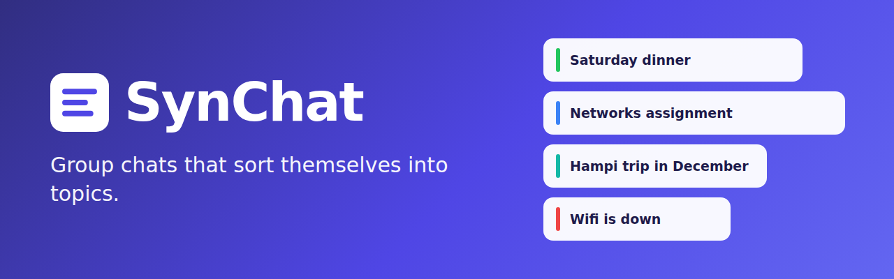
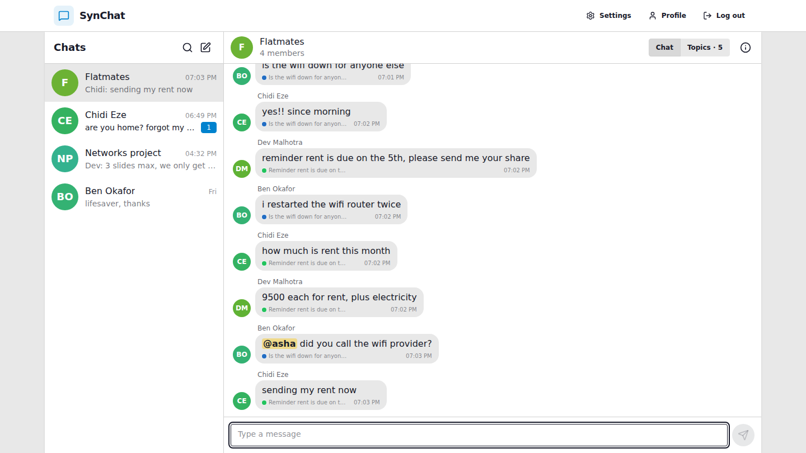
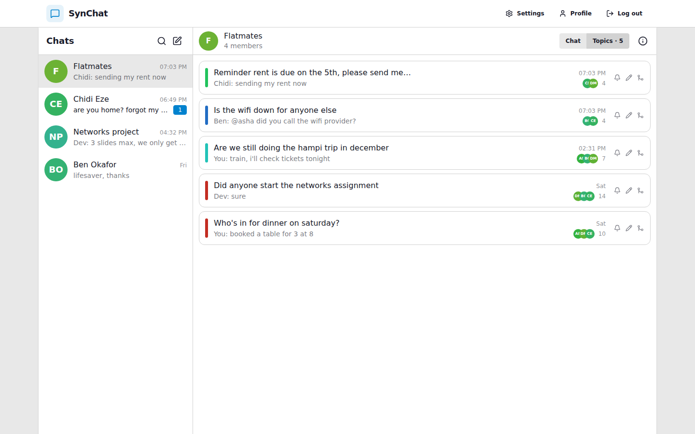
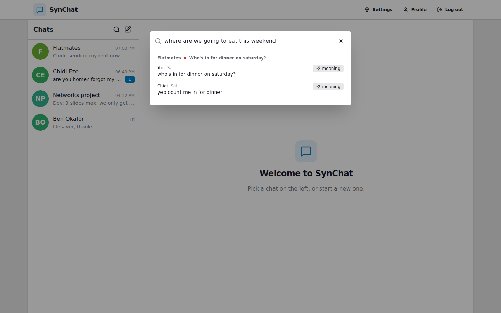
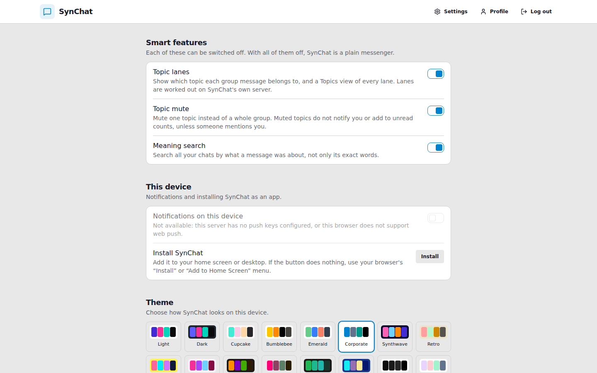
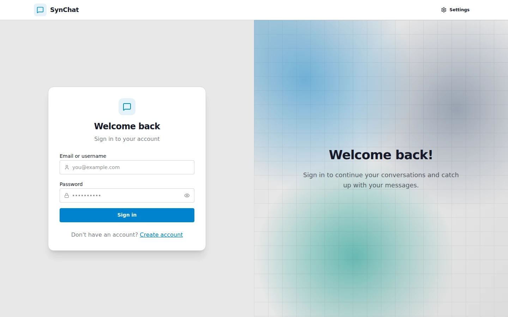
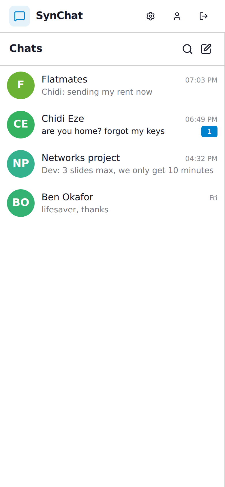
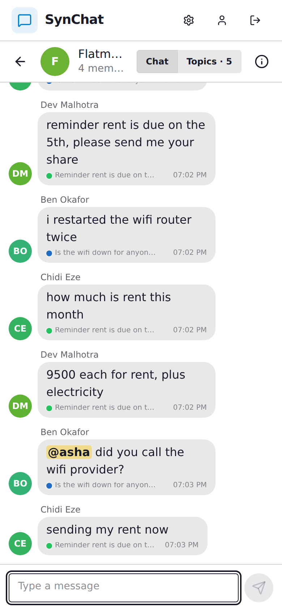

<p align="center">
  
</p>

# SynChat

**A messenger whose group chats sort themselves into topics.**

[](https://react.dev)
[](https://vite.dev)
[](https://expressjs.com)
[](https://www.typescriptlang.org)
[](https://github.com/pgvector/pgvector)
[](https://vercel.com)
[](https://render.com)
[](LICENSE)

**[Live demo: synchat.arvin.life](https://synchat.arvin.life)**: sign in as `asha`, `ben`, `chidi` or `dev` with the password `synchat-demo-2026`. The demo runs on free hosting, so the first load after a quiet spell can take up to a minute while the server wakes up. The demo accounts are shared with everyone who visits, so don't post anything private.

In a busy group several conversations run at once and their messages interleave: dinner plans, an assignment, a trip. Threads do not fix this in casual groups, because nobody starts them. SynChat works out which conversation each message belongs to as it arrives and shows the result as **topic lanes**. Nobody has to do anything.

On hand-labelled test chats the built-in sorter puts 58% of messages in the right lane (41% for doing nothing). In groups whose admin has turned on the optional AI features, a language model re-sorts the chat whenever it goes quiet, and that figure is 86%. How both numbers were measured, and where they fall short, is in the [technical notes](docs/TECHNICAL.md#evaluation).

## 📸 Screenshots

**A group chat, every message labelled with its topic**



**The Topics view of the same chat**



**Search by meaning**



**Settings**



**Sign in**



**On a phone**

<p>
  
  &nbsp;
  
</p>

All screenshots show the demo data created by `npm run seed`.

## ✨ Features

- **Topic lanes.** Every group message is assigned to a topic as it arrives, shared by all members. The normal chat labels each message with its topic; the Topics view shows each lane on its own.
- **Corrections.** Any member can move a message to another topic, merge two topics or rename one. Corrections apply for everyone.
- **Topic mute.** Mute one topic instead of the whole group. Messages that `@mention` you still get through.
- **Meaning search.** Search all your chats by what a message was about, not only its exact words. Keyword and embedding results are merged and grouped by topic.
- **Optional AI features**, off in every group until one of its admins turns them on: a lane tidy-up, a two-line catch-up per topic, a decided-or-still-open status per topic, and one inbox of questions waiting on you. They need a Gemini or Anthropic API key on the server; without one they are hidden.
- **A complete chat app around it.** Direct messages and groups, images, replies, emoji reactions, edit, delete for everyone, read receipts, typing indicators, unread counts and multi-device presence.
- **Groups.** Admins, a name and photo, member management, and expiring, revocable invite links. People are found by exact username or a personal invite link; there is no user directory.
- **Reliable delivery.** Client-chosen message ids make retries idempotent, sends are optimistic and queue while offline, and a reconnecting client fetches exactly what changed.
- **Installable PWA** with a service worker, offline launch, and web push notifications that respect topic mute.
- **Per-person switches** for every smart feature, and 32 themes.

## 🧱 Tech stack

| Layer | What |
|---|---|
| Frontend | React 19, TypeScript, Vite 7, React Router 7, Zustand, Tailwind CSS 4 with daisyUI, react-virtuoso, lucide-react, axios, react-hot-toast |
| Backend | Node.js, Express 5, TypeScript, Socket.IO, zod, helmet, express-rate-limit, bcryptjs, multer |
| Database | PostgreSQL 17 with the pgvector extension, plain SQL through `pg` |
| Embeddings | `paraphrase-multilingual-MiniLM-L12-v2` through `@huggingface/transformers`, run in a worker thread on the server |
| Optional services | Google Gemini (`@google/genai`) or Anthropic (`@anthropic-ai/sdk`) for the AI features, Cloudinary for image storage, Web Push (`web-push`) for notifications |
| Tooling | Vitest and Supertest for the backend tests, Playwright for the browser walk-throughs, ESLint, Docker Compose for the local database |

## 🚀 Getting started

**Prerequisites:** Node.js 22 or newer, npm, and Docker (for the local Postgres).

Clone the repository:

```bash
git clone https://github.com/Arvin-Arun-Dcosta/SynChat.git
cd SynChat
```

Install the dependencies of the root, backend, frontend and e2e packages:

```bash
npm run setup
```

Create your environment file. The defaults work as they are:

```bash
cp .env.example .env
```

Start Postgres 17 with pgvector in Docker, on port 5433:

```bash
npm run db:up
```

Run the API (port 5001) and the web app (http://localhost:5173) in development:

```bash
npm run dev
```

Optionally load the demo data: four people (`asha`, `ben`, `chidi`, `dev`, password `synchat-demo-2026`), two groups and two direct messages:

```bash
npm run seed
```

Build both halves for production:

```bash
npm run build
```

Start the production server, which serves the API and the built web app from one origin:

```bash
NODE_ENV=production npm start
```

Other scripts:

```bash
npm test
npm run typecheck
npm run lint
npm run e2e
npm run db:down
```

`npm test` needs the database up. `npm run e2e` needs `npm run dev` running and `RATE_LIMITS=false` in `.env`.

On first start the API downloads the sentence-embedding model (about 130 MB) into `backend/.cache/`; `npm run model:fetch --prefix backend` (after a backend build) downloads it ahead of time. Database migrations in `backend/migrations/` run automatically at startup.

## 🔧 Environment variables

All variables live in one `.env` file at the repository root; `.env.example` is the template. Only `DATABASE_URL` is required.

| Variable | What it does | Required |
|---|---|---|
| `NODE_ENV` | `development`, `production` or `test`. In production the API serves the built web app and marks the session cookie Secure. | No (default `development`) |
| `PORT` | Port the API listens on. | No (default `5001`) |
| `DATABASE_URL` | Postgres connection string. The database needs the pgvector extension. | **Yes** |
| `CLIENT_ORIGIN` | Extra browser origin(s) allowed to call the API, comma-separated. The API's own origin is always allowed, so this is only needed when the web app is hosted elsewhere. | Only then (default `http://localhost:5173` outside production) |
| `SESSION_TTL_DAYS` | How long a login lasts. | No (default `30`) |
| `TRUST_PROXY` | Number of reverse proxies in front of the API, so rate limits see real client addresses. | No (default `0`) |
| `RATE_LIMITS` | Set to `false` to switch rate limiting off, for the e2e walk-throughs on your own machine. | No (default `true`) |
| `VITE_SITE_URL` | Public address of the site, used for the canonical and Open Graph URLs at build time. Without it a production build leaves those tags out. | Recommended for a public deployment (default `http://localhost:5173` in development) |
| `VITE_API_URL` | Origin of the API, when the web app is hosted apart from it. Empty means the same origin. | Only when the web app and API are on different origins |
| `VITE_API_TARGET` | Development only: where the Vite dev server forwards API and socket requests. | No (default `http://localhost:5001`) |
| `CLOUDINARY_CLOUD_NAME`, `CLOUDINARY_API_KEY`, `CLOUDINARY_API_SECRET` | Image storage. Without them images go to local disk in development and image upload is off in production. | No |
| `ANTHROPIC_API_KEY` | Enables the AI features through Anthropic. | No |
| `ANTHROPIC_MODEL` | Anthropic model to use. | No (default `claude-haiku-5-5`) |
| `GEMINI_API_KEY` | Enables the AI features through Google Gemini. | No |
| `GEMINI_MODEL` | Gemini model to use. | No (default `gemini-3.5-flash-lite`) |
| `LLM_PROVIDER` | `anthropic` or `google`, when both keys are set. | No (default `anthropic`) |
| `DIGEST_QUIET_SECONDS` | How long a group must be quiet before the AI pass runs. | No (default `90`) |
| `DIGEST_MIN_INTERVAL_SECONDS` | Minimum gap between two summaries of the same topic. | No (default `20`) |
| `DIGEST_MAX_WAIT_SECONDS` | Longest wait before the AI pass runs in a group that never goes quiet. | No (default `600`) |
| `LLM_STUB` | Development only: feed the AI screens from a rule-based stand-in, without a key. | No (default `false`) |
| `VAPID_PUBLIC_KEY`, `VAPID_PRIVATE_KEY` | Web push keys. Generate a pair with `npm run vapid --prefix backend`. Without them push notifications are off. | No |
| `VAPID_SUBJECT` | Contact address sent to push services, as a `mailto:` link. | No |
| `COOKIE_SECURE` | Set to `false` only to test a production build over plain http on a LAN address. | No (default: on in production) |
| `AUTO_MIGRATE` | Set to `false` to stop migrations running at startup. | No (default `true`) |
| `BCRYPT_COST` | Password hashing work factor. Never lower than 12 in production. | No (default `12`) |
| `UPLOAD_DIR` | Where local-disk image uploads are kept. | No (default `backend/uploads`) |
| `MODEL_CACHE_DIR` | Where the embedding model is downloaded to. | No (default `backend/.cache/models`) |
| `EMBEDDING_MODEL` | Sentence-embedding model. Changing it means re-embedding stored messages. | No (default `Xenova/paraphrase-multilingual-MiniLM-L12-v2`) |
| `TEST_DATABASE_URL` | Database used by the backend test suite. | No |
| `E2E_BASE_URL` | Address the e2e walk-throughs open. | No (default `http://localhost:5173`) |

## 🗂 Project structure

```
SynChat/
├── backend/
│   ├── migrations/     numbered SQL, applied at startup
│   ├── src/            the API: auth, conversations, messages, realtime, lanes,
│   │                   embedding, search, digest, push, uploads
│   ├── eval/           offline evaluation: datasets, metrics, weight fitting
│   └── test/           tests that run against a real Postgres
├── frontend/
│   ├── public/         icons, web manifest, service worker
│   └── src/            pages, components, stores, lib
├── e2e/                Playwright browser walk-throughs
├── docker/             database init script for local development
├── docs/               technical notes and README images
├── docker-compose.yml  local Postgres 17 + pgvector
├── render.yaml         Render Blueprint for the API
└── vercel.json         build settings for the web app on Vercel
```

The architecture, the lane assigner, the evaluation, the security model and the test coverage are written up in [docs/TECHNICAL.md](docs/TECHNICAL.md).

## ☁️ Deploy your own copy

SynChat has two halves, hosted separately, and both fit on free plans:

- **The web app** is static files. `vercel.json` builds `frontend/` with Vite, publishes `frontend/dist` and sends every page route to `index.html`.
- **The API** is a long-running Node server: it holds WebSocket connections, runs the embedding model in a worker thread and keeps background timers. That does not fit serverless functions, so it needs a host that keeps a process alive. `render.yaml` sets it up on Render.

Put both on subdomains of one domain you own, for example `chat.example.com` for the web app and `api.chat.example.com` for the API. The session cookie is `SameSite=Lax`, so the browser only sends it when the two share a registrable domain; a `*.vercel.app` web app talking to a `*.onrender.com` API cannot sign anyone in.

1. **Database.** Create a Postgres database with pgvector, for example on [Neon](https://neon.tech) (pgvector is available there; migrations enable it). Copy its connection string.
2. **API on [Render](https://render.com).** Fork this repository, then in Render choose **New > Blueprint** and pick your fork. Fill in the values `render.yaml` asks for: `DATABASE_URL`, `CLIENT_ORIGIN` (your web app's origin, e.g. `https://chat.example.com`) and any optional keys. The build downloads the embedding model, and migrations run when the server starts.
3. **Web app on [Vercel](https://vercel.com).** Import your fork with the repository root as the root directory; `vercel.json` supplies the build settings. Add `VITE_API_URL` (your API's origin, e.g. `https://api.chat.example.com`) and `VITE_SITE_URL` (the web app's own origin). Both are read at build time, so redeploy after changing them.
4. **Domains.** Add the web app's domain to the Vercel project and the API's domain to the Render service, then create the CNAME records each one shows you at your DNS provider.
5. **Demo data (optional).** From your machine, with `DATABASE_URL` in `.env` pointing at the new database, run `npm run seed`. It refuses to run with `NODE_ENV=production`.

The free Render plan has 512 MB of memory and sleeps after 15 minutes without traffic, so the first request after that takes up to a minute. The model download happens at build time because downloading and loading it at startup together needs more memory than that.

Alternatively, one Node host can serve everything from a single origin: `npm run build` followed by `NODE_ENV=production npm start` serves the API and the built web app together, with `VITE_API_URL` and `CLIENT_ORIGIN` left empty.

## 📄 License

Released under the [MIT License](LICENSE). Copyright (c) 2026 Dcosta Arvin Arun.

The Ubuntu IRC disentanglement corpus used in the evaluation is from Jonathan K. Kummerfeld et al., "A Large-Scale Corpus for Conversation Disentanglement", ACL 2019 (data licensed CC-BY-4.0). It is downloaded by `npm run eval:data --prefix backend` and is not included in this repository.
