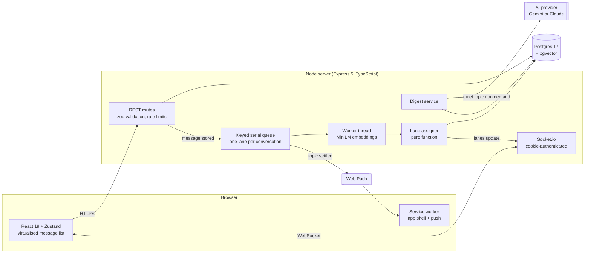

# SynChat technical notes

How SynChat is built, how topic lanes are assigned, how well that works and where it falls short. For setup and an overview, see the [README](../README.md).

**Contents:** [What it does](#what-it-does) · [Architecture](#architecture) · [How lane assignment works](#how-lane-assignment-works) · [Evaluation](#evaluation) · [Search and mute](#search-and-topic-mute) · [AI features](#the-ai-features) · [Security](#security) · [Testing](#testing) · [Limits and next steps](#limits-and-next-steps)

---

## What it does

**Chat.** Direct messages and groups. Text and images, reply-to, emoji reactions, edit, delete for everyone, read receipts, typing indicators, unread counts, and presence that is correct with several devices per person. Groups have admins, a name and photo, member management, and expiring, revocable invite links.

**Finding people.** By exact username, or by a personal invite link you can rotate. There is no way to list or search users.

**Reliability.** The client chooses each message's id, so a retried send can never create a duplicate. Sends are optimistic and queue while offline. Every conversation has a sequence number for ordering and a revision counter for changes; after a reconnect the client asks for exactly what changed since the revision it had.

**Six smart features**, each of which can be switched off:

| | Feature | Runs on | Who can switch it off |
|---|---|---|---|
| 1 | **Topic lanes** — every group message assigned to a topic, shared by all members | our server; re-sorted by the AI provider in groups that have turned it on | each person, for themselves |
| 2 | **Topic mute** — mute one topic, not the group; mentions still get through | our server | each person |
| 3 | **Meaning search** — search all your chats by what a message was about | our server | each person |
| 4 | **Catch-up** — two lines on what you missed in a topic | AI provider | each person; and the group's admin |
| 5 | **Decided or still open** — a status per topic, the outcome pinned once settled | AI provider | each person; and the group's admin |
| 6 | **Questions waiting on you** — one inbox of questions put to you, across all chats | AI provider | each person; and the group's admin |

Features 4 to 6, and the lane tidy-up that goes with them, send a group's messages to an outside AI provider (Google or Anthropic, whichever key the server has). They are therefore **off in every group until one of its admins turns them on**, the switch names the provider and says so in plain words, and flipping it either way is announced in the chat. In a group that has not turned them on, nothing leaves the server. With all six off, SynChat is an ordinary chat app (this is one of the automated walk-throughs).

---

## Architecture



| Layer | Choice | Why |
|---|---|---|
| Backend | Express 5, TypeScript, plain SQL through `pg` | Small, boring, and the SQL that enforces membership is visible at every call site. |
| Database | Postgres 17 with `pgvector` | One store for messages, full-text search and vectors. Replaced MongoDB. |
| Realtime | Socket.io | Kept from the original app; now authenticated from the session cookie. |
| Embeddings | `paraphrase-multilingual-MiniLM-L12-v2` via `@huggingface/transformers`, in a worker thread | Small (384 dimensions), multilingual, about 3 ms per message on CPU, and message text never leaves the server to be embedded. |
| LLM | Gemini (`gemini-3.5-flash-lite` by default) or Claude (`claude-haiku-5-5` by default), behind one small interface (`backend/src/digest/llm.ts`) | Only for the opt-in features. The accuracy figures were measured with the Gemini model. |
| Frontend | React 19, Vite, Zustand, Tailwind 4 + daisyUI, `react-virtuoso` | Kept from the original app; everything is now TypeScript. |

### Layout

```
backend/
  migrations/        numbered SQL, applied at startup
  src/
    auth/            sessions (hashed tokens in Postgres), signup, login
    conversations/   DMs, groups, membership, invites; the one membership gate
    messages/        send (idempotent), edit, delete, reactions, mentions
    realtime/        Socket.io: auth, presence, typing, delivery
    lanes/           the assigner (pure), its text analysis, the service that runs it
    embedding/       the model, the worker, per-conversation centring
    search/          keyword + meaning search
    digest/          the model calls (lane tidy-up, topic digest) and what is built on them
    push/            web push
    jobs/            the keyed serial queue
  eval/              offline evaluation: datasets, metrics, weight fitting, probes
  test/              247 tests against a real Postgres
frontend/src/        pages, components, stores, the service worker in public/
e2e/                 Playwright walk-throughs, one per build phase
```

### The messaging protocol

Each conversation row carries two counters, both incremented while holding that row's lock, so they are gap-free and in commit order:

- `last_seq` orders messages.
- `rev` counts every change: a new message, an edit, a delete, a reaction, a topic assignment. Each changed message is stamped with the `rev` of its latest change.

That gives one catch-up mechanism for everything. A client remembers the highest `rev` it has applied without a gap; `GET /conversations/:id/changes?since=<rev>` returns the current state of every message changed since. Clients call it after reconnecting, and whenever a live event arrives with a `rev` that skips one. If too much changed, the server says "reset" and the client reloads its latest page.

Sending is `POST /conversations/:id/messages` with a client-generated UUID. The server locks the conversation, looks for that id, and either returns the stored message (a retry) or stores it. Eight concurrent retries of one send produce one row; a test does exactly that.

### What would change to run several instances

Nothing has been built for it, but the choices avoid blocking it:

- Events are addressed to per-user Socket.io rooms and membership is read at emit time, so a Redis adapter is a one-line change.
- The job queue is an interface with two methods (`jobs/queue.ts`). The in-process version is the only implementation; a Redis-backed one with a group per conversation fits the same shape. Jobs are safe to run twice, and unfinished work is found again at startup.
- Presence counts and rate-limit counters are the remaining process-local state; both would move to the shared store.

---

## How lane assignment works

The path of one group message:

1. **Send returns immediately.** The message is stored and delivered to everyone with no topic.
2. **A job is queued for its conversation.** Jobs for one conversation run strictly one at a time and in order, so two assignments can never race. Different conversations run side by side.
3. **The message is embedded** in a worker thread, so inference never blocks the event loop.
4. **The assigner decides**, inside one transaction that holds the conversation's lock: join an existing topic, or start a new one.
5. **A `lanes:update` event** tells every member. In the three-browser walk-through the topic chip appears on another person's screen a median of 136 ms after sending.

Two cases are decided outright, with no scoring: an **explicit reply** joins the topic of the message it replies to, and a message **sent from inside a lane** is pinned to that lane at send time.

In a group with AI features on there is a sixth step, a little later:

6. **The tidy-up.** Once the group has been quiet for 90 seconds (or ten minutes after the first unsorted message, in a group that never goes quiet), a language model is shown the last 80 messages and re-sorts them (`backend/src/digest/tidy.ts`). Lanes it has settled before are shown to it; messages that arrived since are shown *without* the local assigner's guess. Whatever it changes reaches everyone as one more `lanes:update`. The instant placement in steps 1 to 5 is unchanged, so a message still gets a lane within a fraction of a second; the tidy-up corrects it a minute or two later.

The model's answer is treated as untrusted. It refers to messages and lanes by short references, and anything that names a reference it was not given is dropped. Three rules are enforced in code, not left to the prompt: a message **a person placed** (a correction, or a send from inside a lane) is never moved; an **explicit reply** stays with the message it replies to; and nothing outside the 80 messages it was shown is touched. If the admin switches AI off, or someone moves a message, while the model is working, that part of its answer is discarded. A provider error changes nothing and the tidy-up is tried again at the next quiet spell.

### The assigner

`backend/src/lanes/assigner.ts` is a pure function: a new message plus the last 200 messages of the conversation in, a decision out. No database, model or clock inside it. The server and the offline evaluation call the same code with the same shapes, so the numbers below describe what runs in production.

It is a **ranking model**. Every recently active topic gets a score, a weighted sum of features describing how well the message fits it. "Start a new topic" gets a score too, from features of the message alone. The highest score wins.

Features of a (message, topic) pair:

| Group | Feature | What it captures |
|---|---|---|
| Meaning | similarity, weighted by how informative the message is | Embedding similarity to what the topic has said. Dissimilarity counts *against* a topic, but only for informative messages. |
| | shared distinctive words | "Q3", "villa", "nvidia". A word used in one topic only identifies it. |
| Recency | topic active just now / earlier in the session | Split by whether the message is short or informative. |
| | what was said in the last few messages | Nearer messages count more. A pure reaction ("lol") gets extra. |
| Author | spoke here just now / earlier / last; share of their recent messages here | People stay in their own threads. The share does not fade with time, so it still points the right way an hour later. |
| | mid-thought | Their own previous line was the last thing said, seconds ago. |
| Turn-taking | it is their turn | The last thing said in the topic was a reply to them. |
| | someone here named them, or asked right after they spoke | |
| Questions | an open question, and this opens like an answer / is short / is long | A question stays open until someone other than the asker replies. |
| | the question asks when or how many, and this contains a number | "what time?" … "8 works". |
| Addressing | names someone who is taking part here | Counts for more in a crowded channel. |

Features of "start a new topic": how informative the message is; whether it is a question that is not itself an answer; whether its content words have not come up at all; a change-of-subject opener ("btw", "also", "quick question"); how long the chat has been silent; whether the author has been away; and how crowded the room is.

### The hard part: short messages

"ok", "8 works" and "lol" carry no meaning of their own. Three things handle them:

- **How informative a message is** is estimated first, from its content words after removing filler (English plus the Hindi/Hinglish fillers our users mix in, with stretched spellings like "nooo" and "okkk" normalised). It runs from 0 for "ok" to 1 for a full sentence.
- **Every meaning feature is multiplied by it.** For "ok" the embedding counts for nothing and the conversational features decide. For a full sentence the reverse.
- **The conversational features are the ones in the table above**: whose turn it is, which question is waiting for an answer, who was named, what was just said.

### Two things learned from measuring

**Embedding similarity is weak evidence for chat messages.** I measured how often meaning alone picks the right lane for a substantial message, given the true earlier lanes (`eval/topic-probe.ts`): about 70%, where chance is 42%. Three larger models did no better, and plain word overlap did as well as any of them. So the embedding is one feature among many, and a small fast model is the right one.

**Raw similarity is not comparable across languages.** Sentence models put texts of one language and register close together whatever they are about, and romanised Hindi is an extreme case: any two Hinglish messages score 0.3 to 0.9, against 0.1 to 0.3 for English. No threshold can serve both. SynChat therefore **centres** similarity per conversation: it subtracts the mean vector of the conversation's recent messages from both sides first (`embedding/centre.ts`). What is left is about 0 for unrelated messages in any language. pgvector does this in SQL; a test checks SQL and the evaluation's TypeScript agree to four decimal places.

### Where the weights come from

`eval/fit.ts` fits them by maximum likelihood: for every labelled message it builds the features from the true topics of the earlier messages and maximises the probability of the true choice, with L2 regularisation. Two adjustments follow, both made on replayed conversations where the model lives with its own earlier decisions:

- Topic starts are rare (8% of casual messages) but missing one sends a whole lane astray, so each counts double in the likelihood, and the new-topic bias is then calibrated on replay.
- The weights of content evidence and of question-answer ties are scaled by 1.5 after fitting. The likelihood fit under-weights them relative to "whatever spoke last" because they fire rarely. This did not change one-to-one accuracy on the tuning chats; it improved VI and the number of exactly right lanes, and cut spurious lanes.

Things tried and rejected, by cross-validated one-to-one on the casual chats at the time (casual-only fitting scored 61 then): fitting on IRC and casual chats together (52 to 54), using the IRC weights as a prior (59), and learning from the model's own replays (51). All three remain available as options of `eval/fit.ts`.

A later round looked at why accuracy drops from 87% of decisions right (given the true earlier lanes) to under 60% when replayed. `eval/oracle.ts` replays with parts of the decision made perfect: on the tuning chats, perfect topic starts alone give 71% one-to-one, and a perfect choice among existing lanes alone gives 80%. So the larger loss is a wrong lane pick that later messages then build on. Three attempts to fix that did not help and were removed: keeping the several most probable groupings alive instead of one (beam search; one-to-one fell to 45%, because the model rates "everything in one lane" as most probable); scoring "does this message follow that lane" with a small language model (SmolLM2 135M picked the right lane 54% of the time, against 81% for simply taking the lane that spoke last); and five interaction features aimed at the catalogued mistakes (no change in decision accuracy, cross-validated one-to-one 56%).

### Topic titles

Without a model: the opening message minus greetings, mentions and links, cut at a word boundary. A topic that opened with "hey guys" is titled by the first message that says what it is about. When the AI features are on for a group, the digest supplies a better title. A title a member chose is never replaced.

### Corrections

Any member can move a message to another topic or a new one, merge two topics, or rename one. Corrections apply for everyone, travel through the same `rev` mechanism as everything else, and are written to `topic_corrections` with what the assigner had decided, as labelled data for later.

---

## Evaluation

Reproduce everything in this section with:

```bash
cd backend
npm run eval:data                                 # downloads the IRC corpus dev + test splits
npm run eval -- --baselines                       # shipped weights on every set
npm run eval -- --params eval/weights/irc.json    # IRC-fitted weights
npm run eval:fit -- --objective casual --boost 1.5 --cv    # leave-one-chat-out
npm run eval:llm                                  # the LLM tidy-up on the held-out chats (needs an API key, about 22 requests)
npm run eval:llm -- --split dev                   # ... on the tuning chats (about 72 requests)
```

**Datasets**

- **Ubuntu IRC** (Kummerfeld et al., ACL 2019), the standard conversation-disentanglement benchmark: 2,500 annotated messages in the dev split, 5,000 in the test split.
- **Casual group chats**: 20 chats I wrote and labelled for this project (`backend/eval/casual/`), each with two to four interleaved conversations among three to five people, about a third in mixed Hindi and English. 15 chats (603 messages) for tuning, 5 (207 messages) held out.

**Metrics** are the standard ones, implemented to match the reference script: VI (100 × (1 − variation of information / log₂ N)), one-to-one (percentage of messages in agreement under the best one-to-one matching of predicted and true conversations), and exact-match precision, recall and F1 over conversations of more than one message. As a check on the implementation, the "link every message to the previous one" baseline reproduces the paper's published figures for it exactly (VI 66.1, one-to-one 27.6).

### Ubuntu IRC, test split

| System | VI | 1-1 | P | R | F1 |
|---|---|---|---|---|---|
| **SynChat assigner, weights fitted on the IRC dev split** | **91.5** | **78.3** | 33.9 | 32.7 | 33.3 |
| Kummerfeld et al. 2019, feedforward, 10-model vote | 91.5 | 76.0 | 36.3 | 39.7 | 38.0 |
| Kummerfeld et al. 2019, feedforward | 91.3 | 75.6 | 34.6 | 38.0 | 36.2 |
| Kummerfeld et al. 2019, linear | 88.9 | 69.5 | 19.3 | 24.9 | 21.8 |
| Elsner & Charniak 2008 | 82.1 | 51.4 | 12.1 | 21.5 | 15.5 |
| Lowe et al. 2017 | 80.6 | 53.7 | 10.8 | 7.6 | 8.9 |
| Baseline: link to previous | 66.1 | 27.6 | 0.0 | 0.0 | 0.0 |
| SynChat assigner, the weights shipped in the product | 66.7 | 28.8 | 12.0 | 0.8 | 1.6 |

Published rows are from Table 4 of the paper. On this benchmark the assigner, fitted on 2,500 messages, matches the paper's feedforward model on VI and is ahead of it on one-to-one, and is behind it on exact-match F1.

Read that number with these caveats:

- **Those are not the product's weights.** They are the same code with weights fitted to IRC. The weights the product ships score no better than the trivial baseline on IRC (last row).
- I fitted on the dev split rather than the much larger train split, and chose the settings on dev. The test split was scored several times during development, in aggregate, so it is not untouched.
- IRC join/quit lines are put on their own by rule, as the app never assigns system lines a topic.
- One run; no significance testing.

### Casual group chats (the product's actual domain)

| Set | Weights | VI | 1-1 | P | R | F1 | Lanes produced / true |
|---|---|---|---|---|---|---|---|
| Held out, 5 chats, 207 messages | shipped | 80.0 | **58.0** | 6.3 | 6.7 | 6.5 | 19 / 15 |
| ↳ baseline: whole chat as one lane | | 79.9 | 40.1 | 0 | 0 | 0 | 5 / 15 |
| Leave-one-chat-out, 15 chats, 603 messages | refit per fold | 83.4 | **56.7** | 11.4 | 10.9 | 11.1 | 54 / 46 |
| ↳ baseline: whole chat as one lane | | 83.2 | 41.6 | 0 | 0 | 0 | 15 / 46 |
| Held out, 5 chats | IRC-fitted | 63.4 | 37.2 | 0 | 0 | 0 | 48 / 15 |

Given the true earlier lanes, the shipped weights make the right choice for 81% of held-out messages. Replayed from scratch, where an early mistake leaves lanes mixed for every later message, that becomes 58% one-to-one.

### With the LLM tidy-up

The same chats, replayed the way the app runs with AI features on: every message is placed by the local assigner as it arrives, and each time the chat pauses for 90 seconds the model re-sorts it (57 pauses in the tuning chats, 17 in the held-out ones). The lanes left at the end are scored. Model: `gemini-3.5-flash-lite`.

| Set | Pipeline | VI | 1-1 | P | R | F1 | Lanes produced / true |
|---|---|---|---|---|---|---|---|
| Held out, 5 chats, 207 messages | local assigner only | 80.0 | 58.0 | 6.3 | 6.7 | 6.5 | 19 / 15 |
| | **+ tidy-up at each pause** | 94.0 | **86.5** | 50.0 | 53.3 | 51.6 | 16 / 15 |
| | one tidy-up after the last message | 98.2 | 97.6 | 75.0 | 80.0 | 77.4 | 16 / 15 |
| Tuning, 15 chats, 603 messages | local assigner only | 85.1 | 59.5 | 17.0 | 17.4 | 17.2 | 56 / 46 |
| | **+ tidy-up at each pause** | 98.7 | **96.2** | 82.0 | 89.1 | 85.4 | 50 / 46 |
| | one tidy-up after the last message | 98.7 | 96.0 | 78.4 | 87.0 | 82.5 | 51 / 46 |

**The number to quote with AI features on is 86% one-to-one on held-out chats**, up from 58%, with half the lanes exactly right instead of one in sixteen. Read it with these in mind:

- **It is five chats.** Per chat the tidied result was 95, 83, 73, 100 and 82%. One chat going differently moves the total by several points, and the model's answers vary a little from run to run. This is one run; the answers are cached in `eval/.cache` so that re-running the script gives the same figures.
- **The held-out chats were used once to choose the design.** The first version showed the model the local assigner's lane for every message and asked it to correct mistakes. That scored 74.4% held out, while the same model sorting from the text alone scored 85%: being handed a wrong guess made it worse. The tidy-up was rebuilt to hide the guess for unsorted messages and then run once on each set, with no prompt changes after. So 86.5% is a held-out figure for the prompt, but not for that one design decision. (`npm run eval:llm -- --show-guesses` replays the earlier design, with today's prompt.)
- **Early decisions stick.** Held out, re-sorting at every pause (86.5%) does worse than sorting once at the end (97.6%): a lane settled when only half a conversation had happened is rarely revisited. The tuning chats show no such gap (96.2 against 96.0), so I do not know how large the effect really is.
- **It applies to a chat that has paused.** Between a message arriving and the next quiet spell it sits where the local assigner put it, at the 58% level. In a group that never pauses the wait is capped at ten minutes.
- **It applies only where an admin has turned AI on.** Everywhere else the lanes are the local assigner's, with the weaknesses listed below.
- **The chats are synthetic and short.** I wrote them, each has clean topics and about forty messages, and a language model is probably better at chats that read like examples than at a real group's. Nothing here measures a chat longer than the 80-message window, where the model sees older lanes only by their titles.
- **Other models are unmeasured.** No Anthropic key was available, and the free tier of the Gemini API allows about twenty requests a day on the larger `gemini-3.6-flash`, which was not enough to finish one run.

### Where the local assigner does badly

**Without the tidy-up, the number to quote is about 57% one-to-one on casual group chats, against 41% for doing nothing.** That is a real improvement, and it is also a long way from "the lanes are right". Specifically:

- **By VI it is no better than leaving the whole chat as one lane** (80.0 against 79.9 held out). Only 6 to 11% of lanes are exactly right. The gain shows up in one-to-one accuracy alone.
- **Topic starts are the weak point.** On the held-out chats it missed 8 of 15 starts and invented 12 that were not there. A change of subject in the middle of a fast exchange, with no pause and right after an unanswered question, is usually put in the lane that was just active. Each miss costs every later message of that topic.
- **A short follow-up tends to go to whichever lane spoke last**, even when it is plainly the author's turn elsewhere. Both this and the previous point are written down as expected-failure tests in `backend/test/assigner.test.ts` under "known limitations".
- **It over-splits more often than it mixes**: 19 lanes for 15 true topics. That is the cheaper mistake (a merge is one action; untangling a mixed lane is many), and it is why the UI makes merging easy.
- **Results vary a lot by chat**: 35% to 84% one-to-one across the 15 cross-validated chats.
- **The domains do not transfer, in either direction.** IRC weights are worse than the baseline on casual chats; casual weights are at the baseline on IRC. A crowded public help channel, where people address each other by nick and most new voices start a conversation, is a different problem from five friends.
- **Romanised Hindi** gets less from the embedding than English does. Centring makes the scale usable; it does not make the model understand the text.
- **The casual set is small, synthetic and mine.** I wrote the chats and the assigner. Twenty chats by one author are an easier and narrower test than real groups, and which sub-topics count as separate is a judgement call a second annotator would make differently. The held-out five were also scored in aggregate while I iterated, so treat them as lightly used.

What I would do next is in [Limits and next steps](#limits-and-next-steps).

---

## Search and topic mute

**Meaning search** (`backend/src/search/`) runs two searches over the caller's own conversations and merges the rankings with reciprocal rank fusion:

- *Keyword*: Postgres full-text search with the `simple` configuration (no stemming, which would mangle romanised Hindi), prefix-matching each word. Filler words are dropped from the query when it contains anything else.
- *Meaning*: nearest neighbours of the query's embedding through a pgvector HNSW index, with iterative scan so that the membership filter cannot starve the result.

Each list finds what the other misses: "where are we going to eat this weekend" has no word in common with "who's in for dinner at the ramen place on saturday?", which it returns first; a name or a number has no meaning to embed. Results are grouped by topic. If the model is unavailable, search falls back to keywords and says so.

**Topic mute** is personal. A muted topic stops counting toward that member's unread badge and stops notifying them, except for messages that `@mention` them. Mentions are resolved against the conversation's members when a message is sent. Because a group message's topic is only known a moment after it arrives, push notifications for group messages are sent from the lane job, once the topic is settled; that is what lets them honour mute.

---

## The AI features

Two kinds of request go to the model, both from `backend/src/digest/`: the **lane tidy-up** described under [How lane assignment works](#how-lane-assignment-works), and the **topic digest**, a single structured request per topic that catch-up, decided-or-open and the questions inbox all read from.

This relaxes one decision the project started with, that topic assignment runs only on our server. It still does for every group by default. In a group whose admin has turned AI features on, the provider also re-sorts that group's messages, and the switch says so.

- **When it runs.** When the group has been quiet for 90 seconds: first the tidy-up, then a digest of each topic that changed. A digest also runs when a member asks for a catch-up. Never per message, not more than once per 20 seconds per topic, and never with nothing new. At most the last 80 messages are sent, each cut at 500 characters.
- **What is sent.** First names and short references ("P2", "m7"). No ids, usernames or email addresses.
- **The request.** One call through the provider's official SDK: no tools, no conversation state, and the response constrained to a JSON schema, which is validated again on our side. `GEMINI_API_KEY` selects Google, `ANTHROPIC_API_KEY` Anthropic; with both set, `LLM_PROVIDER` chooses.
- **Quotas.** A busy group makes one tidy-up request per quiet spell plus one per topic that changed. A free-tier Gemini key is rate-limited per minute and per day; when the provider refuses, nothing changes and the work is retried at the next quiet spell. Check your provider's data terms before turning this on for real people: as I read Google's, content sent on the free tier may be used to improve its products, and content sent on a paid key is not.
- **Message text is untrusted input.** The system prompt says messages are data, not instructions. Each message sits in its own tag with its text escaped, so text cannot close the tag and pose as structure.
- **The output is untrusted too.** It is validated against what was sent: a question that points at a message we did not send, at someone who is not a member, or at its own author is dropped. Every string is cut to a bounded length and stripped of control and direction-override characters. The client renders it as plain text.
- **Members stay in charge.** Any member can override a topic's status; an override is never overwritten, and is logged as a correction. A question leaves the inbox when you reply to it, when a later digest sees it answered, or when you dismiss it.
- **Turning it off deletes it.** When an admin switches AI off for a group, the summaries, statuses and questions the model produced for that group are deleted. Lanes stay as they are, and from then on only the local assigner touches them.

`LLM_STUB=true` (development only, ignored when a key is set) feeds these screens from a rule-based stand-in that is not AI, so they can be worked on without a key.

---

## Security

The problems in the original code, and what replaced them:

| Was | Now |
|---|---|
| The socket trusted a `userId` in the query string, so anyone could connect as anyone | Sockets are authenticated during the handshake from the same httpOnly session cookie as the API. The handshake also checks `Origin`, which CORS does not cover for WebSockets. Logging out drops that session's sockets. |
| `GET /api/messages/users` returned every user with their email | No endpoint lists users. Lookup is by exact username or invite code, rate-limited, and never returns an email. |
| No rate limiting | Per-IP and per-account limits on login and signup; per-user limits on sending, uploads, search, lookups and AI requests. |
| No input validation | Every body, query and path parameter is parsed with zod. |
| CORS origin hard-coded to localhost | `CLIENT_ORIGIN` setting; state-changing requests from any other origin are refused. |
| 6-character passwords | 10-character minimum, common passwords refused, bcrypt cost 12 (never lower in production). |
| Images as base64 inside 10 MB JSON bodies | Multipart uploads capped at 5 MB, typed from their bytes rather than the filename (no SVG), stored under random names. JSON bodies are capped at 64 KB. |
| An invalid token returned 500 | 401. Sessions are random tokens stored only as SHA-256 hashes, so logout really revokes. |

**Membership.** Every read and write of a conversation's data goes through one gate, `requireMember`, or through a query that joins `conversation_members` for the caller. A non-member gets `404`, the same answer as for an id that does not exist. This is covered for every route: history, catch-up, sending, read state, edits, deletes, reactions, replies across conversations, reused message ids, group administration, invite links, topics, corrections, mute, search (by keyword and by meaning), the AI endpoints, the inbox and push; over HTTP and over the socket; and for members who have just been removed.

Deliberate decisions worth knowing:

- **No end-to-end encryption.** Topic assignment and search run on the server and need the text.
- New group members can read the group's earlier history.
- Signup tells you if an email is already registered (there is no email verification step to hide behind); it is rate-limited.
- Uploaded images are served from unguessable URLs without a session check, as on most messengers.

---

## Testing

**Backend: 245 tests pass, plus 2 that record known limitations** (`npm test`). They run against a real Postgres, rebuilt from the migrations each time. Coverage follows the risks: auth and sessions; the membership gate on every route; ordering under concurrent sends; idempotent retries, including racing ones; reconnect catch-up; multi-device presence; the pure assigner and each of its features; the queue; the metrics, checked against hand-computed values and brute force; mute, mentions and search; the digest, including hostile model output and the exact shape of the request sent to Claude; push.

**Browser walk-throughs** (`e2e/`, Playwright): each phase of the build was exercised as two or three people in separate browser sessions, and the scripts are kept.

| Script | What it walks through | Checks |
|---|---|---|
| `phase1.mjs` | DMs, a group, unread badges, presence, typing, sending while offline, reload, logout | 8 |
| `phase2.mjs` | Replies, reactions, edit, delete, receipts, images, group admin, removal, invite links, 300-message history, two-device presence | 14 |
| `phase3.mjs` | Interleaved conversations separating into lanes, timing, corrections | 11 |
| `phase4.mjs` | Topic mute, mentions, search by meaning and keyword, feature switches | 11 |
| `phase5.mjs` | The AI switch, status, inbox, catch-up, overrides | 13 |
| `phase6.mjs` | Against the production build: manifest, service worker, offline launch, all features off | 7 |

They found real bugs that unit tests had not, among them: the typing indicator being dropped right after a send; topic mute being ignored for chats whose topics were not loaded; catch-up never appearing because opening a chat marks it read; and the embedding worker failing to load in the production build.

### What has not been verified

- **The real Claude API call.** No Anthropic key was available. The request's shape, error handling and refusal handling are unit-tested against a stubbed SDK call, and the features are tested against a scripted stand-in, but no request has been sent to that API. The Gemini path has been run for real: the accuracy figures above, and the tidy-up and digests on the seeded demo group through the running server.
- **The tidy-up on long or real chats.** Every measured chat fits in one 80-message window and was written for the test.
- **Cloudinary uploads.** No keys were available; images were tested with the local-disk store.
- **Push delivery to a browser.** Automated browser contexts have no Push API. Who is notified, topic mute, mentions, and subscription lifecycle are tested on the server with a recording sender; subscribing and receiving in a real browser has not been.
- **Mobile browsers and screen readers.** The layout is responsive and controls are labelled, but neither was tested on a device.

---

## Limits and next steps

- **Lane accuracy without the AI provider** is still the thing to improve, and the evaluation says where: topic starts. The most promising directions are (a) real labelled data, which the product now collects every time someone corrects a lane; (b) letting the assigner revise its last few decisions when a new topic clearly begins, instead of committing each message once; (c) a small learned model of "does B continue A" in place of pairwise similarity.
- **The tidy-up's early decisions stick** (see the evaluation). Re-sorting the window from scratch each time, and matching the result back onto the existing lanes so their ids stay stable, would probably close the gap to the "one tidy-up at the end" figure; it needs measuring on chats that were not used to choose it.
- **Catch-up is per topic, not per reader.** It summarises the topic's most recent stretch, which is the same for everyone, so that one digest can be cached per topic.
- **One server instance.** See "What would change to run several instances".
- **No message retention policy, export, blocking or reporting.** A friends-and-family messenger needs at least blocking before strangers can reach each other; today you can only be reached by someone who has your exact username or invite link.
- **The embedding model is fixed at 384 dimensions** in the schema. Changing models means re-embedding stored messages.

---

## Acknowledgements

The Ubuntu IRC disentanglement corpus and its evaluation method are from Jonathan K. Kummerfeld et al., "A Large-Scale Corpus for Conversation Disentanglement", ACL 2019 (data licensed CC-BY-4.0). The corpus is downloaded by `npm run eval:data` and is not included in this repository.
